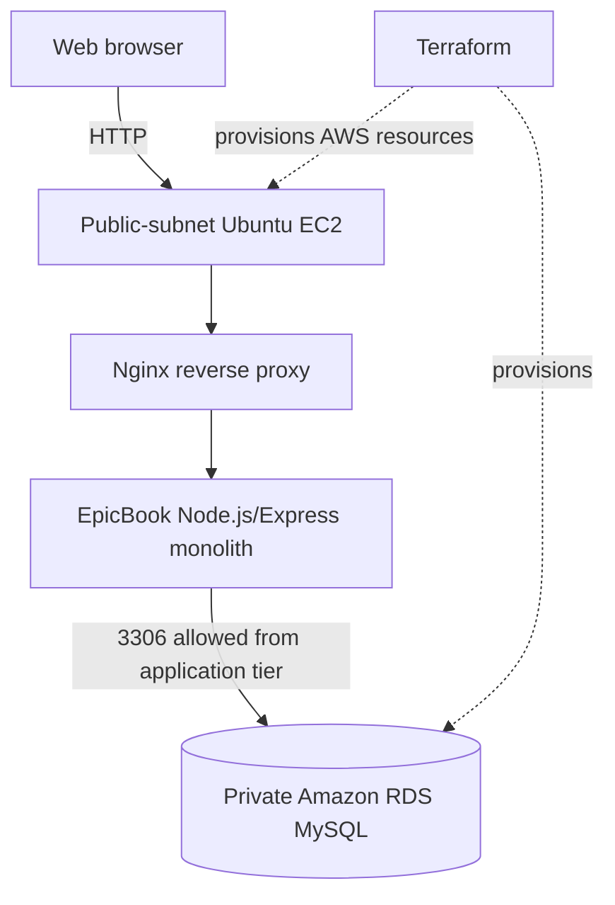
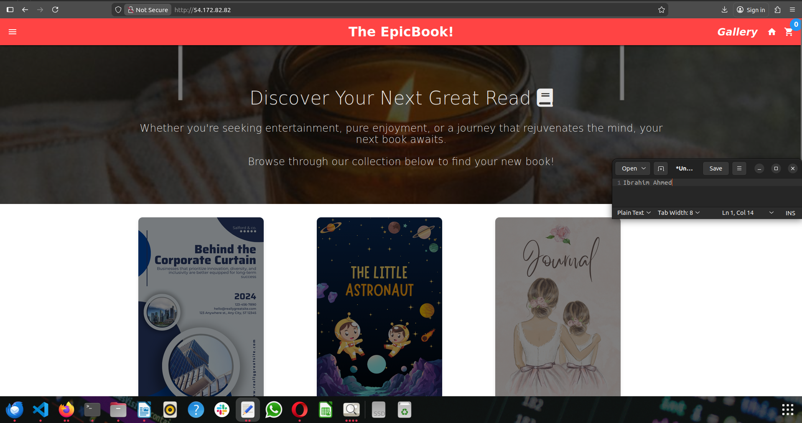

# AWS EpicBook — Terraform Deployment

**Infrastructure as Code | Amazon EC2 | Amazon RDS MySQL | Node.js/Express | Nginx**

This repository documents the **Week 10, Assignment 4** deployment of the EpicBook monolithic bookstore application on AWS. Terraform was used to provision a VPC, networking, security groups, an Ubuntu EC2 instance and an RDS MySQL database. The application was configured on EC2, served through Nginx and connected to the RDS instance. Screenshots and practical findings are from the original internship report.

> **Project scope:** This is the **Terraform-based AWS implementation**. The application is monolithic even though its database runs in a separate infrastructure tier. It is distinct from the earlier manually provisioned EpicBook project. This ZIP contains **documentation and evidence only**; add your own reviewed Terraform files separately.

## Architecture

[Editable diagram source](diagrams/architecture.mmd)

## Infrastructure and implementation

- **Networking:** custom VPC; public and private subnets; Internet Gateway and route table.
- **Compute:** Ubuntu 22.04 EC2 instance in a public subnet, with SSH and HTTP access controlled by security groups.
- **Database:** Amazon RDS for MySQL in private database subnets. The report describes adding subnets in different Availability Zones to satisfy the RDS subnet group requirement.
- **Application:** original EpicBook Node.js/Express code; Nginx reverse proxy; MySQL connection configured through runtime environment settings.
- **Verification:** browser access to the bookstore, MySQL table inspection, sample book records and reported cart/checkout tests.

## Evidence from the internship

| Evidence | Screenshot |
|---|---|
| Terraform provisioning output | [Deployment](screenshots/01-terraform-deployment.png) |
| EC2 instance | [EC2 overview](screenshots/02-ec2-console.png) |
| RDS connectivity configuration | [RDS overview](screenshots/03-rds-console-connectivity.png) |
| EpicBook running in a browser | [EpicBook homepage](screenshots/05-epicbook-homepage.png) |
| Database tables verified via MySQL | [Database tables](screenshots/08-mysql-database-tables.png) |
| Terraform EC2 output | [EC2 output](screenshots/09-terraform-ec2-output.png) |

See the complete [screenshot evidence index](screenshots/README.md).

## Documentation

- [Infrastructure and deployment](docs/DEPLOYMENT.md)
- [Troubleshooting and validation](docs/TROUBLESHOOTING.md)
- [Security, evidence limitations, and publishing checklist](docs/SECURITY-AND-VERIFICATION.md)

## Skills demonstrated

Terraform, AWS VPC, EC2, RDS MySQL, public/private subnet routing, security groups, Linux server administration, SSH, Nginx reverse proxies, Node.js/Express deployment, MySQL and Sequelize troubleshooting, infrastructure validation and incident resolution.

## Attribution

- **Original EpicBook application:** [pravinmishraaws/theepicbook](https://github.com/pravinmishraaws/theepicbook). The application was provided for internship exercises, not originally authored by this repository owner.
- **Terraform-based cloud implementation, troubleshooting and documentation:** [@slim274](https://github.com/slim274), DevOps Micro Internship Cohort 2.

## Status

This repository records a **completed internship exercise**, not an always-running production service. Historical IP addresses and database endpoints from the report are not current availability guarantees. No HTTPS, secrets manager, automated application bootstrap or ongoing failover testing is established by the evidence.
